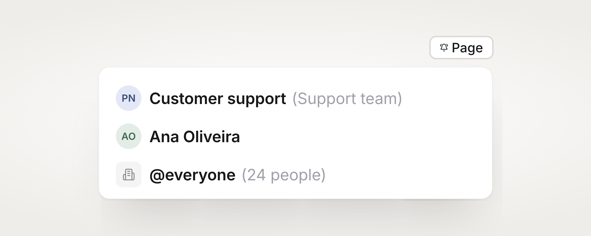

# Paging people

<figure><figcaption>
Page an on-call schedule, a person, or everyone in your organisation.
</figcaption></figure>

Your escalation policy decides who gets alerted automatically. **Page** is for the moment that is not covered by a policy: you need a specific person, another team's on-call, or everyone, and you need them now.


**Paging someone does not add them to the incident.** A page is an alert and nothing more. If you want someone on the incident, [reassign it or add them as a responder](reassign-incidents.md) — that is a separate action.


## Three ways people get paged

| | What it is |
| --- | --- |
| **Escalation policy** | The automatic path. When an incident triggers, the policy alerts each step in order until someone acknowledges. See [Escalation policies](../escalations/introduction-to-escalations.md). |
| **Alert routing rule** | An automated page. A rule can page a set of people, schedules or teams as soon as a matching incident is created. See [Alert routing rules](../alerts/alert-rules.md). |
| **The Page button** | By hand, from an open incident. This page is about that. |

An alert routing rule's page and a page you send by hand behave the same way: the same targets, the same sharing, the same cooldowns.

## How to page

Open an incident and click **Page**. A list opens next to the button, so the incident stays visible. You can also press **⌘K** and choose **Page people or on-call**.

Whoever is on call for the incident's team is listed first, by name. Then the team's people, everyone else, other teams' on-call schedules, and **@everyone** last.

<!-- TODO screenshot: the Page popover open on an incident, showing the "On call now" section and a row's three buttons. Save as .gitbook/assets/incidents/incidents-paging-list-1.png -->

You can page:

- **A person**
- **An on-call schedule** — whoever holds that pager right now
- **Everyone in a team**
- **A team's on-call** — everyone on call on any of that team's schedules
- **@everyone** — every active member of your organisation


Paging another team's people or schedules shares the incident with that team, so they can open it and act on it. You'll see which teams were added under the list after the page goes out.


### Keyboard

- `↑` / `↓` move the highlight
- `↵` pages the highlighted row and moves to the next
- `Esc` closes the list
- Group rows — a whole team, a team's on-call and **@everyone** — are **held for a second**, not clicked. Let go early and nothing is sent.

## Choose how to reach them

Every row has three buttons. Hover or focus one and the row tells you what it would do.

| Button | What it reaches | Plan |
| --- | --- | --- |
| **Alert everywhere** | A push to their mobile app if they have it, an email always, and a Slack DM and a Microsoft Teams DM where those are linked. Never a phone call. | All plans |
| **Mobile app** | Their mobile app and nothing else. Critical by default, so it breaks through Do Not Disturb and the silent switch. | All plans |
| **Phone call** | Rings their phone, and nothing else. | Business and higher |

**Alert everywhere** is the rightmost button and the one `↵` presses. The louder two need a deliberate click of their own.

**Critical alert** is on every time the list opens, and applies to the **Mobile app** button only. Turn it off to send an ordinary push that waits politely.


There is no SMS or WhatsApp option when paging. Those channels are still used by escalation policies and your personal alert settings.


## Phone calls

Calling from an incident needs the **Business plan or higher**. On other plans the button is shown locked, with the upgrade next to it, so you never press it and then get refused.

**You cannot call a group.** @everyone, a whole team and a team's on-call have no **Phone call** button at all. A single on-call schedule does: it resolves to whoever holds that pager, which is one person.


If a schedule has several layers running at the same time, more than one person is on call — and a call to that schedule rings each of them.


### When a call can't go out

The row tells you which of these it is, and what to do about it:

| What you see | What it means |
| --- | --- |
| **Nobody on call right now** | The schedule has no one on it at this moment. |
| **No phone number on file** | They have never added one. |
| **Number on file but never verified** | They added a number but didn't finish verifying it. |
| **Phone calls are not on your plan** | Upgrade to Business or higher. |

For the middle two, the row offers **Ask them to add a phone number**. Spike emails that one teammate the link to add and verify their number, plus the QR code that saves Spike as a contact — which is what decides whether a 3am call is answered or declined as an unknown number.

Asking is bounded: **2 asks per person per day**, and **20 asks per sender per day**. Someone who already has a verified number can't be asked.

## How often the same person can be paged

Anyone paged about an incident in the last **5 minutes** isn't paged again on that same button. Press a different button and it goes through — the 5 minutes are counted per person, per incident, per channel, so pressing the bell never disarms the phone.

Phone calls are the exception:

1. A call holds the same **5 minutes** while its result is unknown.
2. Once the call is known to have **connected**, that person can't be called again about this incident for your organisation's call gap — **6 hours** unless your organisation has been set to something else.

That is deliberate. A call that reached nobody must not burn six hours of the one channel that wakes people, so an unconfirmed call is retryable after five minutes.

## What Spike can tell you, and what it can't

The Page list tells you what each button **will try** — "Rings app, email and Slack" — not what arrived. Spike has no per-channel delivery receipts, and there is no read-back of whether someone acknowledged after a page.

For phone calls there is an outcome, which is not the same as a receipt. The row can say the last call **went unanswered**, **went to voicemail**, **was declined**, or that their phone was **unreachable**.

The list also only remembers the pages **you** sent from this browser tab. Reload the page and it starts empty — except for phone calls, where the cooldown and the last call's outcome come from Spike itself. If a teammate already paged someone in the last five minutes, you'll see it when your own page comes back as **Already paged in the last 5 minutes**.

## On the timeline

A page that alerted at least one person is recorded on the incident's timeline: who paged, who they paged, the channels it went out on, and the counts. A page that alerted nobody — everyone was paged moments ago, or nobody is on call — is not recorded, because nothing happened. The list still tells you why.


You can't page about a **resolved** incident. Reopen it first.


## Paging a responder

Each responder's row in the **Responders** list carries the same bell, next to **Remove**. It pages that one person without changing anything else about the incident.
