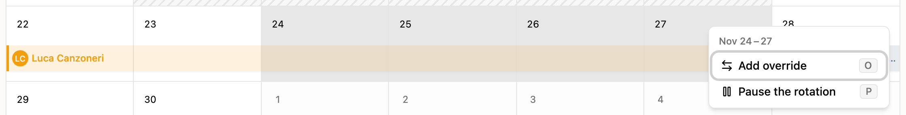
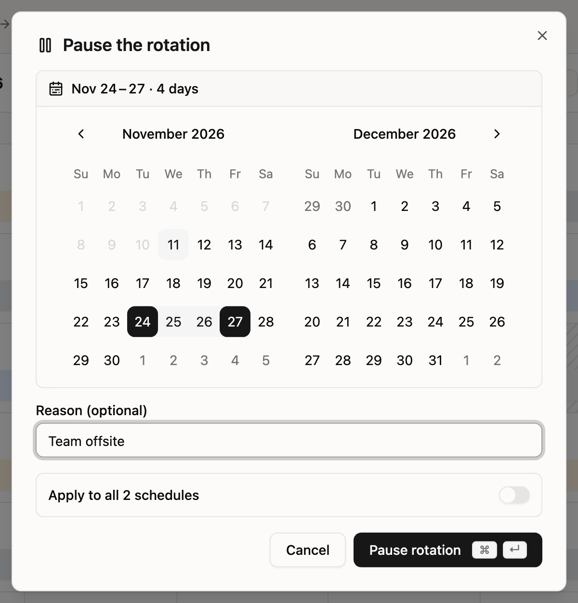
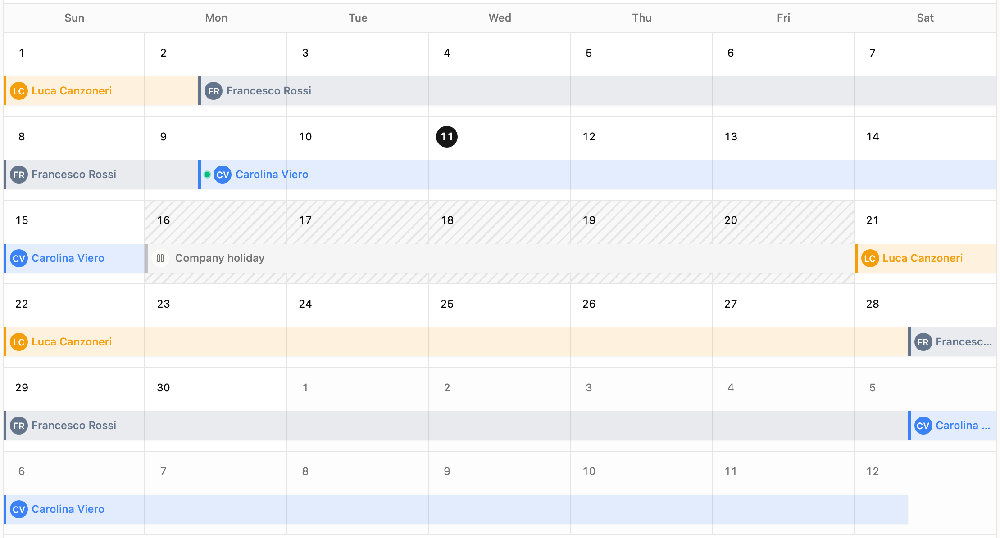
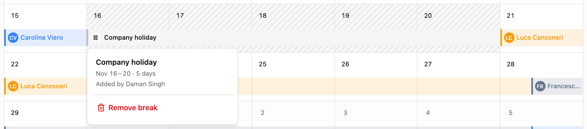
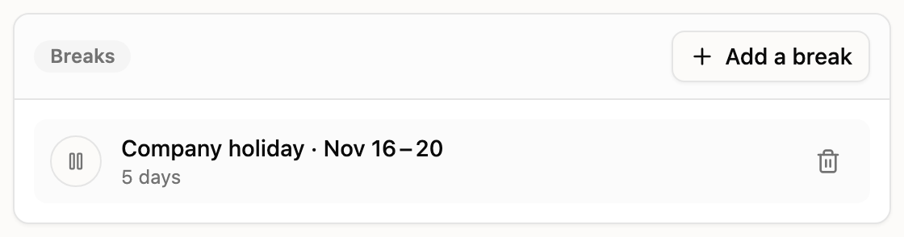

# Pause the rotation

Use a break when your team takes time off together, for example over the year-end holidays. A break pauses the rotation of a schedule for the days you choose.

## What a break does

- **Nobody from the schedule is on call during the break.** A break pauses every layer of the schedule.
- **The shift that was running resumes after the break.** The person on call when the break starts gets the time they had left when it ends.
- **Everyone after moves later by the length of the break.** Nobody loses a turn and nobody gets an extra turn.
- **Overrides still apply.** An override inside a break shows on the calendar and receives alerts as usual. To have someone cover a break, add an [override](override-an-on-call.md).

A break covers whole days in the schedule's timezone: from midnight on the first day to midnight after the last day. Nobody from the rotation is on call on any of those days.

Every layer pauses for exactly the days you choose. On a layer that rotates weekly, a break that is not a whole number of weeks moves the later handoffs to another weekday. For example, a one-day break on a Monday rotation moves every later handoff to Tuesday.

A schedule with a weekly layer that has slots (set hours, for example Monday 08:00 to Friday 18:00) only accepts breaks that are a whole number of weeks. Otherwise the slots would stop lining up with the handoffs and leave hours with nobody on call. The dialog suggests the nearest whole-week end date.

## Example

A schedule rotates every two weeks between Luca, Francesco and Carolina. The handoff is on Monday at 08:00.

Francesco's shift starts on Monday 14 December. The team adds a break from 21 December to 3 January. Nobody from the rotation is on call from midnight on 21 December to midnight on 4 January, two weeks.

| Week starting | Without a break | With a break from 21 Dec to 3 Jan |
| ------------- | --------------- | --------------------------------- |
| 7 Dec         | Luca            | Luca                              |
| 14 Dec        | Francesco       | Francesco                         |
| 21 Dec        | Francesco       | Nobody (break)                    |
| 28 Dec        | Carolina        | Nobody (break)                    |
| 4 Jan         | Carolina        | Francesco                         |
| 11 Jan        | Luca            | Carolina                          |
| 18 Jan        | Luca            | Carolina                          |
| 25 Jan        | Francesco       | Luca                              |

Francesco works the week of 14 December. He had one week left when the break started, so he works it from 4 to 8 January. Carolina starts on 11 January instead of 28 December. Everyone after her also moves two weeks later.

## Pause the rotation from the calendar

1. Open your [on-call schedule](https://app.spike.sh/on-calls).
2. Drag across the days you want to pause.
3. Choose **Pause the rotation**, or press **P**. The dialog opens with the days you selected.

<figure><figcaption>
Drag across days, then choose Pause the rotation.
</figcaption></figure>

You can also click **Pause rotation** at the top of the schedule, next to **Override**, or press **P**. This is the way to pause on a tablet, where you cannot drag. The dialog opens with no days selected.

## Set up the break

The dialog has these fields:

- **Days:** pick the first and last day of the break on the calendar in the dialog. Click one day for a one-day break, or click a second day to make a range. The line above the calendar shows the days you picked and how many there are. The break includes both days.
- **Reason:** optional. Spike shows the reason on the calendar, for example "Holiday break".
- **Apply to all N schedules:** off by default. Turn it on to add the same break to every schedule of your current team. Each schedule keeps its own copy of the break, so you can remove it from one schedule and keep it on the others.

A break can be at most 366 days long. The first day must be today or later. Two breaks on one schedule cannot overlap. Schedules with a weekly layer that has slots need a break of whole weeks: if your days are not whole weeks, Spike tells you when you save and offers the nearest whole-week end date. When you apply a break to all schedules, Spike skips any schedule that already has a break on those days or needs a break of whole weeks, and tells you which schedules it skipped.

Click **Pause rotation** to save the break.

<figure><figcaption>
Pick the days of the break on one calendar.
</figcaption></figure>


During a break, the on-call step of any escalation policy that uses this schedule finds nobody on call and is skipped. To have someone cover the break, add an [override](override-an-on-call.md) for those days.


## Breaks on the calendar

A break shows as a hatched band across the paused days, with its reason as the label. During the break, the calendar shows no shifts from the schedule. Overrides still show.

<figure><figcaption>
A break on the on-call calendar.
</figcaption></figure>

Click the band to see the details of the break: when it starts and ends, its length, who added it, and who resumes after it. If the break was applied to all schedules, the details also show how many other schedules have it.

<figure><figcaption>
Break details, where you can also remove the break.
</figcaption></figure>

## Add breaks when you create or edit a schedule

When you create or edit a schedule, the **Breaks** section is below the layers. It lists the upcoming breaks of the schedule. Click **Add a break** to open the same dialog.

- **New schedule:** Spike saves the breaks when you save the schedule.
- **Existing schedule:** Spike saves each break as soon as you add or remove it.

Past breaks are not listed in the form. They stay on the calendar.

<figure><figcaption>
The Breaks section in the schedule form.
</figcaption></figure>

## Remove a break

Click the break on the calendar, or click the trash icon next to it in the **Breaks** section of the schedule form. Then choose one of these:

- **Remove break** (in the form, **Remove from this schedule**): removes a break that has not started yet, from this schedule only.
- **Remove from all N schedules:** removes every copy of the break. This option shows only for a break that was applied to all schedules.

Spike asks you to confirm before it removes a break.

### End a running break early

When a break has started, the action is **End break now** (or **End on all N schedules**). The days of the break that already passed stay paused, so nobody gets those days on call after the fact. The rotation resumes right away. On a schedule that needs breaks of whole weeks, the break ends at the next whole week instead.

You cannot remove a break that has ended. The shifts it moved already happened.


On a weekly rotation, choose a break that is a whole number of weeks long, for example 21 December to 3 January. Then every handoff after the break stays on the same weekday.


## FAQs

### Does a break change linked calendars?

No. [Linked calendars](linked-calendars.md) stay reference-only, and a break does not change them. A holiday on a linked calendar does not pause the rotation. To pause the rotation for a holiday, add a break.

### What happens to escalations during a break?

The escalation step that uses the schedule finds nobody on call and is skipped. When you page the schedule from an incident, Spike tells you the rotation is paused and when it resumes. If an override covers the break, the person in the override receives the alerts.

During a break, the on-call indicator in the dashboard header, the `/oncall` command in Slack and the Spike MCP server show the schedule as paused, with the time it resumes.

### Can I pause one layer only?

No. A break pauses the whole schedule, with every layer in it. To change one layer only, use an [override](override-an-on-call.md) or edit the [layer](introduction-to-layers-in-on-call-schedules.md).

### Who can add or remove breaks?

Anyone who can edit the schedule.

### Which plans include breaks?

All paid plans.
