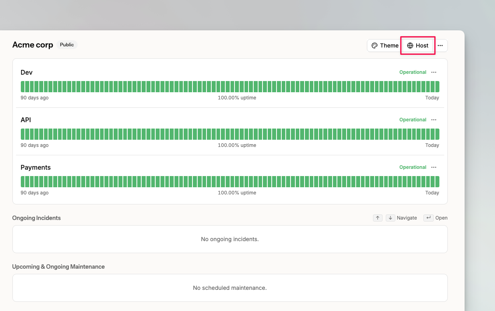
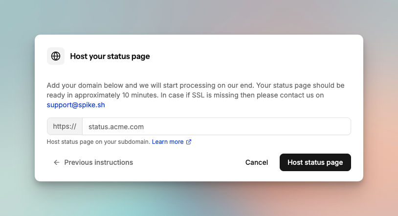

# Add a custom domain to your status page

## Step 1: Add your domain in Spike

Click **Host** in the top-right corner of your status page.

<figure><figcaption></figcaption></figure>

Enter your custom domain, for example `status.acme.com`.

<figure><figcaption></figcaption></figure>

## Step 2: Update your DNS settings

In your domain's DNS settings, add a CNAME record pointing to `alias.spike.sh`.

Spike issues a certificate for your domain so your status page loads correctly over HTTPS.

DNS changes can take up to 10 minutes to propagate.

## Step 3: Check the domain status

The **Domain** section of your status page settings shows where the domain stands: **Live**, **Waiting for DNS**, **Needs your action**, or **We're on it**, with the one thing to do next. Spike checks the domain a few seconds after you save it and every hour after that.

Spike gives each domain one CNAME target. For most domains it is `alias.spike.sh`. A few DNS setups cannot be served from that address, for example a Cloudflare zone with a hold on subdomains. In that case the Domain section asks you to point the CNAME at `alias2.spike.sh` instead, and that is the only time to use it. Always use the target shown in Spike.


If your status page does not appear on your custom domain after 30 minutes, contact [support@spike.sh](mailto:support@spike.sh) with the status the Domain section shows.

